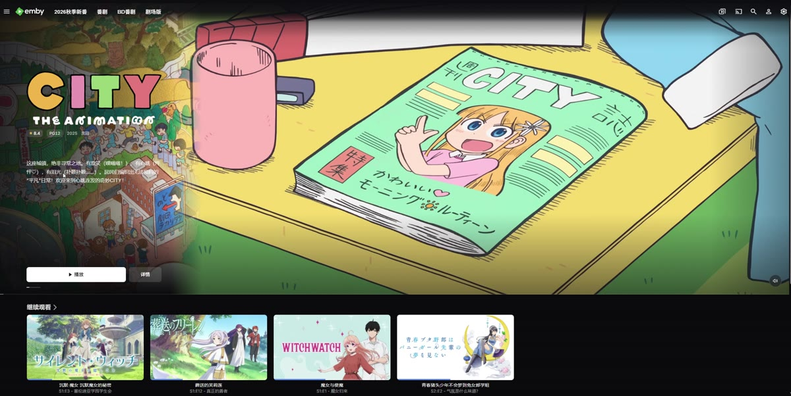
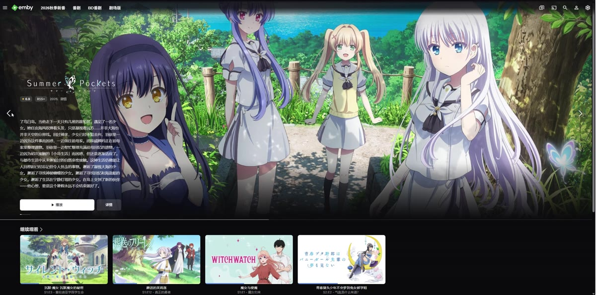
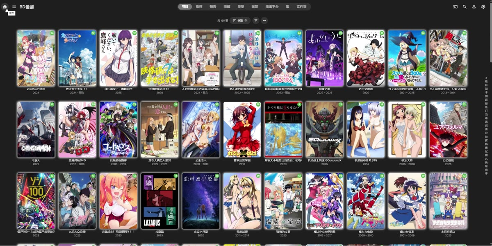
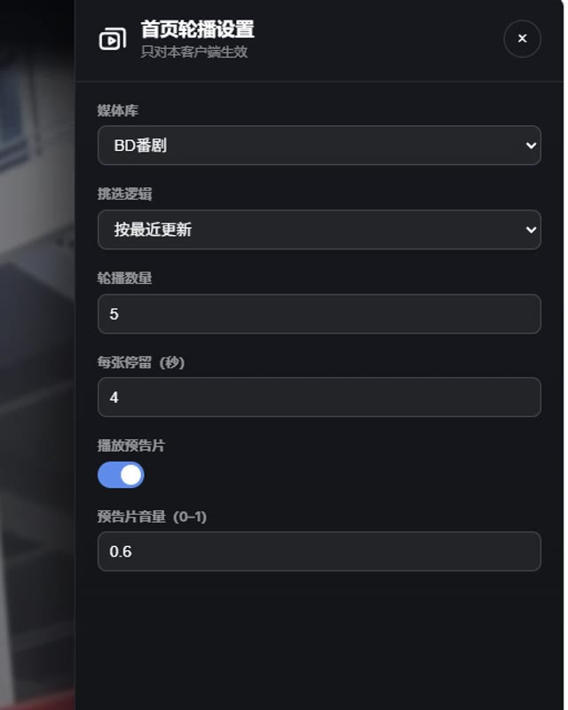

# 模块 ①：首页轮播（HomeSwiper）

> 属于 **Emby-JS-Glow** 套件　·　当前版本 **v1.0**　·　[返回套件说明](../README.md)

**把 Emby 首页顶部变成"带预告片的电影轮播"。** 一个文件、粘贴即用。

> ⚠️ **运行前提：Emby 必须装有 CustomCssJS 插件**（自定义 CSS/JS）。本脚本不是 Emby 插件，而是通过该插件注入的脚本。

`v1.0`　·　Emby 4.7 / 4.11　·　单文件部署

---

## 特点

|             |                                                           |
| ----------- | --------------------------------------------------------- |
| **单文件**     | 全部内联（Swiper 库 + 样式 + 逻辑），粘贴进 Emby 的 CustomCssJS 即可，无需改服务端 |
| **自动播预告片**  | 读取条目 `trailers` 目录下的本地预告片，有声优先、被浏览器拦截则降级静音并等你第一次操作补声      |
| **进度条**     | 图片阶段显示"还有多久翻页"，预告片阶段显示播放进度                                |
| **静音按钮**    | 预告片右下角，鼠标移到轮播区才出现，两态图标                                    |
| **长简介自动滚动** | 放不下时缓慢循环上滚（提词器式），放得下就不动                                   |
| **两态布局不跳**  | 图片→视频切换时，标题/评分/标语/按钮位置一个像素都不动                             |
| **不破坏原生**   | 轮播只是首页内容里的第一块，下面的分区、滚动、顶栏都保持 Emby 原生行为                    |

## 效果展示

以下均为 **Emby 4.11 网页端实机录屏**（无声、未加速、未剪辑）。点击封面即可在浏览器里播放原片。

> GitHub 的 README 不渲染内联视频播放器，所以这里用「封面图 + 链接」：点封面 → 打开对应的 mp4。
> 录屏源文件在 [`demo/`](../demo)，封面取自视频原帧，放在 [`readme/assets/demo/`](assets/demo)。

### 1. 本地预告片轮播 · 23s

[](../demo/本地trailer轮播.mp4)

读取条目 `trailers` 目录下的**本地预告片**，有声优先、被拦截则降级静音。播完自动翻到下一张；右侧视频与左侧标题／评分／按钮同时切换，位置一个像素都不动。

### 2. 图片轮播 · 17s

[](../demo/图片轮播.mp4)

没有预告片（或设置里关掉「播放预告片」）时的纯图片轮播：剧照铺满整屏、缓慢推近，左侧信息层保持不动。

### 3. 简介滚动 · 11s

[](../demo/简介滚动.mp4)

简介放不下时缓慢上滚（提词器式），滚到底停一下再回到开头；放得下就完全不动——不裁剪、不加省略号。

### 4. 导航栏快速进入媒体库 · 10s

[](../demo/导航栏快速进入媒体库.mp4)

顶栏的**媒体库条**挂在 Emby 原生 `headerMiddle` 上，点库名直接进那个库（文件夹仍走 Emby 自己的 list 路由），不用先退回首页再点。

### 5. 独立设置 · 5s

[](../demo/独立设置.mp4)

设置面板只写本机：**只对本客户端生效**（存在浏览器本地），不影响别人的界面。改完保存立即生效，无需刷新。

## 前置依赖（必须）

本脚本**不是** Emby 插件，必须通过 **CustomCssJS** 插件注入才能运行。

1. Emby 后台 → **插件 → 目录**；
2. 搜索 **Custom CSS and JS**（作者 `InfiniteSky` 的版本即可）；
3. 安装 → 重启 Emby；
4. 重启后，后台 → 设置 → 侧栏出现 **自定义 CSS/JS（CustomCssJS）** 这一项，才算装好。

> 没装这个插件，页面上没有任何地方能粘贴 `HomeSwiper.js`，脚本也没有执行入口。

## 环境要求

- **Emby Server** 4.7 / 4.11（已实测 4.11.0.9）
- 客户端：网页端（Chrome/Edge 内核）与 **Emby Theater**（Electron 18 / Chromium 100）均已适配
- 条目需要有 **Backdrop（背景图）** 才会进轮播；预告片来自 `trailers` 子目录（可选）

## 安装

1. 确认已装 **CustomCssJS** 插件（见上「前置依赖」）；
2. Emby 后台 → **设置 → 自定义 CSS/JS（CustomCssJS）**；
3. 打开 `HomeSwiper.js`，**全选复制**，整份粘贴进去（覆盖旧内容）；
4. 保存；
5. 回首页 **Ctrl+F5** 强制刷新。

打开浏览器控制台，看到这一行就说明装好了：

```
[HomeSwiper] b20261025140557
```

> 当前模块的日志前缀仍是 `[HomeSwiper]`（代码里的历史名），下一版会统一成 `[Glow]`。  
> **判断是否装好，看构建标签 `b20261025140557` 即可。**

## 设置

点顶栏右侧的轮播图标（或设置页里的入口）打开面板：

| 项       | 说明          | 默认     |
| ------- | ----------- | ------ |
| 媒体库     | 从哪个库抽条目     | 第一个可见库 |
| 挑选逻辑    | 目前支持"按最近更新" | 最近更新   |
| 轮播数量    | 每轮抽多少条      | 20     |
| 每张停留（秒） | 图片阶段停留时长    | 10     |
| 播放预告片   | 关闭后全程图片轮播   | 开      |
| 预告片音量   | 0–1         | 0.6    |

> **改任何设置保存后立即生效**（不刷新）。代价是轮播会整块重建、并回到第一条。

## 常见问题

**Q：后台找不到「自定义 CSS/JS」这一项？**  
说明 **CustomCssJS 插件没装或没重启**。先按上面「前置依赖」装好并重启 Emby。

**Q：装好了但首页没变化？**  
先看控制台有没有 `[HomeSwiper]` 前缀的日志（这是当前模块的历史前缀）；没有说明脚本没执行（检查是否粘贴完整、是否被浏览器扩展拦了）。

**Q：右侧不播预告片？**  
三种可能：① 该条目没有本地预告片（`trailers` 目录）；② 设置里关了"播放预告片"；③ 面板太窄（窗口宽度不足 680px 时不播）。控制台的 `[HomeSwiper:trailer]` 日志会逐条说明原因。

**Q：没有声音？**  
浏览器不允许"无用户交互时的自动播放带声音"，脚本会降级静音并在你第一次点击/按键时补上声音。也可以直接点右下角静音按钮。

**Q：改完设置感觉卡了一下？**  
这是整块重建（设计如此）。

**Q：怎么彻底卸载？**  
清空 CustomCssJS 里的内容，保存并强制刷新。脚本不会在服务端留下任何东西。

## 版本

### v1.0（首个公开版本 · 套件第 1 个模块）

- 首页整屏轮播：剧照背景 + 可读信息层 + 播放/详情
- 预告片层：右侧面板、有声优先、失败重试、播完自动翻页
- 进度条（图片倒计时 / 预告片进度）、静音按钮、长简介自动滚动
- 顶部媒体库条、设置面板（改完即时生效）
- 兼容网页端与 Emby Theater
- **依赖 CustomCssJS 插件**（非 Emby 插件本身）
